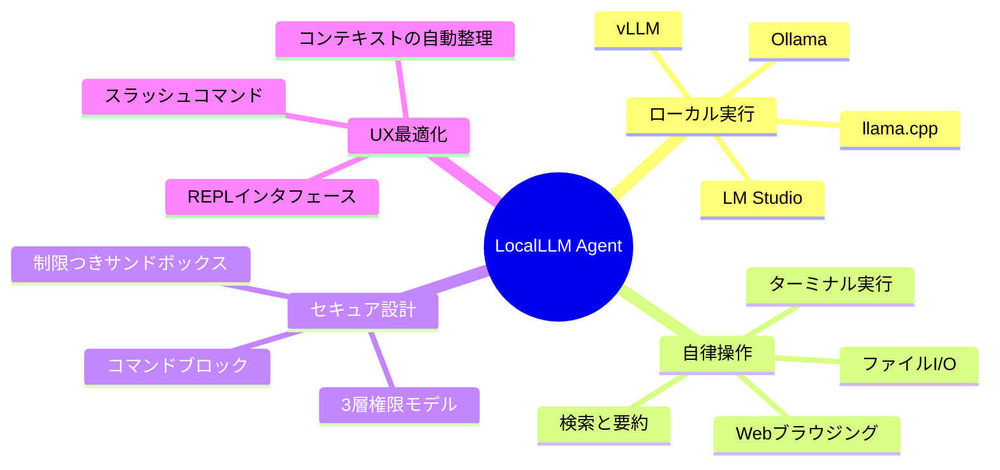
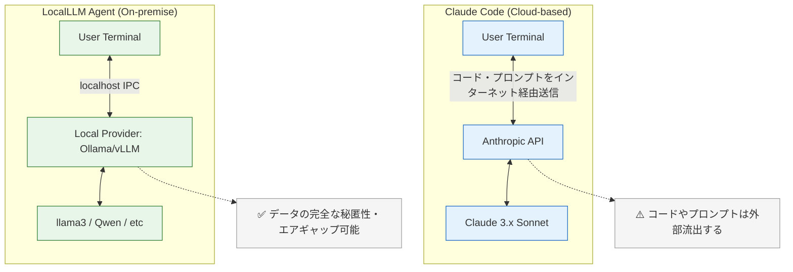
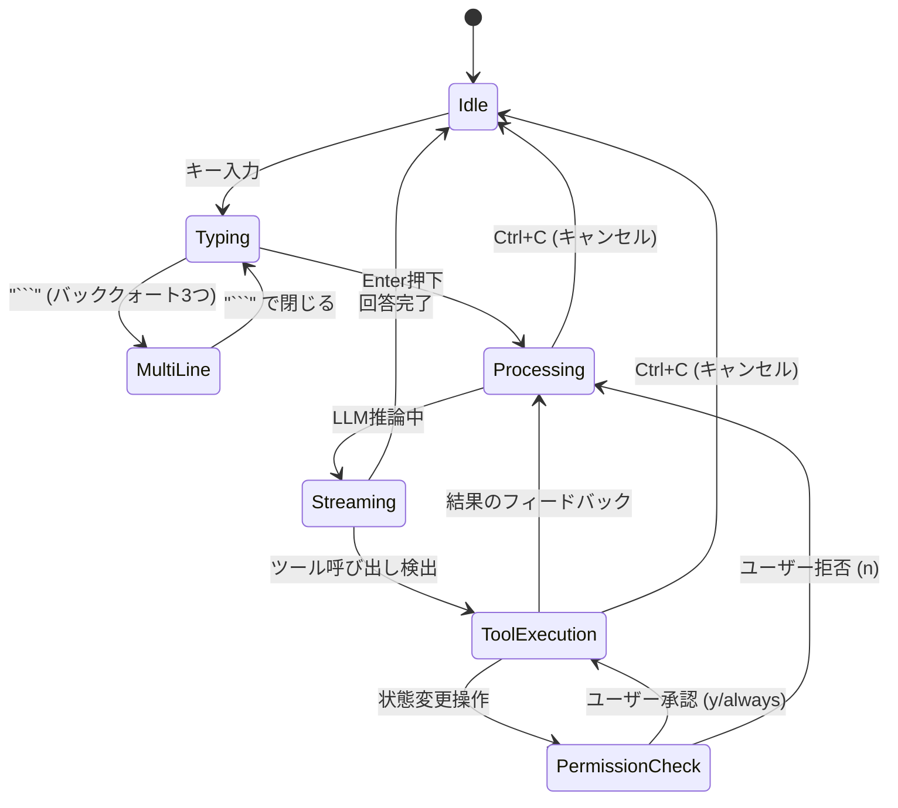
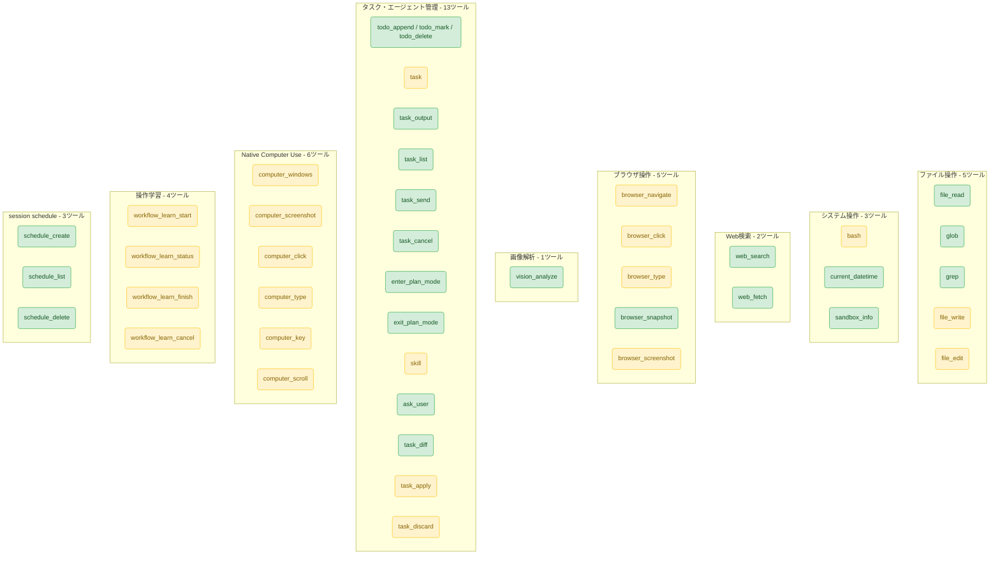
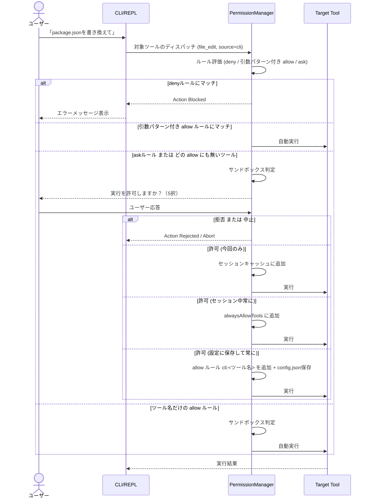

# 外部設計書 (External Design)

> **バージョン**: 統合版 (2026-03-15) / 2026-10-25 docs 整理で実装と照合し直した
> **対象**: LocalLLM Agent の実装済み機能 (package.json の version 0.5.3 時点)。 未実装の構想は docs/README.md の「構想・計画」 を見る

本ドキュメントでは、LocalLLM Agent の外部仕様（ユーザー向け機能・インターフェース・動作要件）について定義します。

---

## 1. システム概要

LocalLLM Agent は、ローカルで稼働するLLM（大規模言語モデル）を活用した **CLI型AIエージェント** です。ユーザーのPC上で自律的に動作し、ファイルの読み書き、Web検索、ブラウザ操作、コマンドの実行などを通じてタスクを遂行します。Claude Code にインスパイアされた対話型の REPL インターフェースを提供します。

### 1.1 主な特徴とユースケース



### 1.2 Claude Code との比較

LocalLLM Agent は Claude Code の「シームレスなCLI体験」「自律的なツール実行」を踏襲しつつ、**データプライバシーの絶対的な保護** と **ランニングコストゼロ** を主な目的として開発されています。



| 比較項目 | Claude Code | LocalLLM Agent |
| :--- | :--- | :--- |
| **推論基盤** | クラウド (Claude 3.x 等) | **ローカルオンプレミス** (Ollama, LM Studio等) |
| **運用コスト** | 従量課金 (APIトークン消費) | **無料** (マシンの電気代のみ) |
| **プライバシー** | ソースコードが外部APIサーバに送信される | **完全オフライン動作可能** |
| **ツール数** | 30以上 | **約 50 種** (§3参照、設定・機能トグルに応じて登録。 数の正はソース `src/tools/definitions/`) |
| **サブエージェント** | 4タイプ (Task tool) | **組み込み 5 種** (explore / plan / general-purpose / bash / code-reviewer) + 利用者定義 (§9) |
| **プランモード** | 組み込み | **組み込み** (idle→planning→awaiting_approval) |
| **スキルシステム** | Skill tool + `/command` | **対応** (builtin + ユーザー定義) |
| **コンテキスト管理** | 大容量コンテキスト (200K+) | **自動整理** (次の呼び出しが必ず入る予約で時期を決め、 決まった規則で消してから足りないときだけ要約。 書き換えは 1 回の整理で 1 回。 §2.3) |
| **ブラウザ操作** | 主にファイル操作・コマンド実行 | **Playwright統合** (クリック・入力・スクショ・a11yツリー) |

---

## 2. ユーザーインターフェース (UI)

### 2.1 REPL コマンドラインUI

エージェントはターミナル上で動作し、コマンドプロンプト形式でユーザーの自然言語入力を受け付けます。



### 2.2 スラッシュコマンド一覧

| コマンド | 説明 |
|----------|------|
| `/help` | ヘルプや使用可能なコマンド一覧を表示します |
| `/exit` (別名 `/quit`) | エージェントを終了します |
| `/clear` | 現在の会話履歴とコンテキストをクリアします |
| `/context` | 現在のコンテキスト（トークン）使用状況と整理の状態・今 `/compact` した場合の見込みを表示します |
| `/compact` | コンテキストを今すぐ整理します（段階 0〜3 を最後まで。結果の内訳を表示） |
| `/handoff` | 引き継ぎメモを残してコンテキストをリセットします（手動のリセット。 `/handoff dry` はメモを表示するだけ、 `/handoff from-file <path>` は保存済みメモで LLM を呼ばずにリセット。 docs/handoff-design.md） |
| `/model` | 現在のスロット (main / second / vision) 状況を表示します。 編集は `/models` (登録レジストリ) または `/model <slot> <verb>` |
| `/models` | 登録モデルの一覧 → アクション (Set as main/second/vision / Edit / Duplicate / Delete / Add new) |
| `/swap` | main ⇔ second のスロット入れ替え |
| `/plan` | タスクを事前に分析・設計する「プランモード」を手動で開始します |
| `/skills` | 追加ロードされているスキル（builtin含む）の一覧を表示します |
| `/status` | セッション全体の状態を 1 画面で表示 (slot / context / capability / metrics / cost / tasks) |
| `/todo` | 現在のTODOリストを表示します |
| `/resume` | セッション復元 (引数なしで picker / `latest` で最新 / `list` で一覧) |
| `/rename` | 現在のセッションを命名し、保存済み一覧と picker へ即時反映します |
| `/memory` | 永続メモリの内容を表示します |
| `/remember` | 指定した情報を永続メモリに記録します |
| `/diff` | stage済み・未stage・未追跡を含む working tree の実Git差分を表示します。Git不在・非repository・出力上限超過は復旧方法付きで失敗します |
| `/integrations` | 外部統合 (Discord / Slack / Chatlog / Search) を 1 画面で設定 |
| `/permission` | 権限ルール (`security.rules` の allow / deny / ask) を画面で編集。 範囲はすべての面 / CLI / Discord / Slack |
| `/stream` | 表示モード (ストリーミング / スピナー+Markdown) を toggle |
| `/loop` | プロンプトを定期実行 (例: `/loop 5m /pr-review`)。 一覧 + 停止は `/loop status` |
| `/autorun` | 自律実行モードの toggle |
| `/fork` | 現在の会話を新しいセッションへ分岐します (元のセッションは変えない。 `latest` も可) |
| `/room` | Room (A/B/C) の一覧・切り替え・自動再開の設定。 サーフェスごとの会話の分離 (docs/room-model-design.md) |
| `/queue` | 受信順キューの待ち状況の表示 (`clear` で待ちを消す) |
| `/tasks` | バックグラウンドの task / worktree の一覧 |
| `/cost` | LLM 使用量とコスト (計測窓 / today / month / models / providers / export / rate / reset)。 docs/cost-token-command-design.md |
| `/parallel` | ツールの同時実行数の確認・変更 (既定 1 = 逐次) |
| `/try` | 試行錯誤モード (§13) |
| `/goal-loop` | 決定的な検証コマンド (`--check`) の終了コード 0 まで反復 (docs/goal-loop-deterministic-check-design.md) |
| `/goal-seek` / `/exit-goal-seek` | Goal Seek mode の開始 / 終了 (docs/goal-seek-mode-design.md) |
| `/checkpoint` | 自動チェックポイント (シャドウ Git) の on/off・一覧・差分・復元 (docs/checkpoint-and-smoke-design.md) |
| `/sandbox` | bash の OS 封じ込めの状態・on/off・allow/deny (docs/wsl-sandbox-design.md) |
| `/mcp` | MCP サーバーの状態・全体の on/off・個別の toggle・再読み込み |
| `/knowledge` | Obsidian ナレッジベースの検索・最近のノート・タグ (docs/obsidian-integration.md) |
| `/image` | 画像生成の状態・プロファイル設定・生成 (`/image gen`)。 docs/image-generation.md |
| `/compress-input` | opt-in 入力圧縮モードの切り替え (docs/input-compression-design.md) |
| `/learn` | 操作学習の状態 (docs/workflow-learning.md) |
| `/doctor` | 環境診断 (LLM 接続 / Playwright / Discord / Slack / 画像生成 / ディスク使用量) |
| `/loglevel` | 運用ログのレベルの確認・変更 (docs/llm-logging.md) |
| `/tui` | TUI 表示と mouse capture の状態・切り替え (docs/tui-alternate-screen.md) |
| `/run` | 実行中の作業の一時停止と再開。 `/run pause` は進行中の応答と tool を完了させ、 次の LLM API 直前で会話と再開地点を保存して止める (アプリ・PC を終了しても `/resume <id>` → `/run resume` で続けられる)。 `status` / `resume` / `inspect` / `discard`。 docs/durable-run-resume-design.md |

※ 一覧の正は補完の定義 (`src/cli/completer.ts` の `BUILTIN_COMMAND_DEFS` と `src/cli/commands/` のレジストリ)。 スキルは `/<スキル名>` (または frontmatter の `trigger`) でも呼べる (§10)。 `@second <依頼>` で始めた入力はセカンド LLM に直接委任する (§12)。
※ `/setup` は REPL コマンドではなく、 CLI 起動時のフラグ `--setup` で実行します。
※ 起動時にセッションを復元するフラグは REPL の `/resume` と同じ書き方: `--resume <id>` / `--resume latest`。 引数なし `--resume` (REPL では picker) は起動前に picker を出せないため使い方エラー、 見つからない ID・保存セッション無しもエラー終了 (終了コード 1) で、 黙って新規セッションで始めない。 旧 `--continue` は削除済み (→ `--resume latest`)
※ 同じことをするコマンドは 1 つだけにしている (docs/archive/todo-legacy-ways-cleanup.md)。 次の旧コマンドは削除済みで、 入力しても動かない:
  - `/sessions` `/continue` (→ `/resume list` / `/resume latest`)、 `/second` (→ `/model second`)、 `/profiles` `/profile` `/model-registry` `/registry` (→ `/models`)
  - `/integration` `/intg` (→ `/integrations`)、 `/switch` (→ `/swap`)、 `/token` (→ `/cost`)、 `/model url` `/model ip` (→ `/model host` + `/model port`)、 `/loop list` (→ `/loop status`)、 `/stream on|off` (→ 引数なし `/stream`)
  - `/metrics` `/capability` (→ `/status`)、 `/run pause --durable` (→ `/run pause`。 一時停止は保存して止める 1 方式だけ)
  - `/discord` `/slack` `/chatlog` `/search` (→ `/integrations` の画面)、 `/permission <サブコマンド>` (`auto-add` `rule-add` 等 → 引数なし `/permission` の画面)
  - `/forget` `/forget mode` `/forget status` `/forget dry` (→ `/compact`。 何を忘れるかを LLM に選ばせる忘却は廃止)、 `/context strategy` (区切りでの使い分けの表を廃止。 代わりは無い)。 docs/context-reduction-redesign.md §7
  - 2026-10-25 (同じ目的のやり方の一本化。 §2.6):
    `/model setup` `/model second setup` `/model vision setup` (→ `/models` → Add new)、 `/model temperature` `top_p` `top_k` `rep_penalty` `description` と `/model second …` `/model vision description` の同名 (→ `/models` → Edit)、
    `/model info` `/model second status|info` `/model vision status|info` (→ 引数なし)、 引数なしの `/model second model` (→ `/model second list`)、
    `/cost model` `/cost provider` (→ `/cost models` / `/cost providers`)、 `/loop stop` (→ `/loop status`。 端末が無いときはエージェントに頼む)、 `--no-alt-screen` `--no-mouse` (→ 環境変数 `LLLMAGENT_DISABLE_*`)
  - `/quit` は `/exit` の別名として残す (Claude Code と同じ)

#### `/models` (Model Registry) — main / second / vision 統合管理

詳細: `docs/model-registry.md`

| サブコマンド | 説明 |
|---|---|
| `/models` | 登録モデル一覧 → エントリ選択 → Set as main / Set as second / Set as vision / Edit / Duplicate / Delete / Add new... |
| `/models list` | 一覧のみ表示 (操作なし) |
| `/models help` | 使い方表示 |

#### `/model <slot>` — スロット別操作

| サブコマンド | 説明 |
|---|---|
| `/model` | main / second / vision の状態を 1 画面で表示 |
| `/model list` | main slot の利用可能モデル一覧から選択 |
| `/model context <値>` | main slot のコンテキスト長を変更 (例: `128k`) |
| `/model <名前>` / `/model host` / `port` / `provider` | main slot のモデルの直接指定 / 接続先の変更 |
| `/model second <sub>` | second slot 操作 (`enable` / `disable` / `list` / `model <名前>` / `context` / `host` / `port` / `provider`) |
| `/model vision <sub>` | vision slot 操作 (`list` / `context` / `clear`) |

新規の追加 (旧 `/model setup` / `/model second setup` / `/model vision setup`) は `/models` → Add new (スロットとプロバイダを選ぶ wizard) だけ。
temperature / top_p / top_k / rep_penalty / description の編集 (旧 `/model temperature` 等・`/model [second\|vision] description`) は `/models` → Edit だけ (割り当て中のスロットなら設定に反映してその場で適用)。
引数なしの `/model` / `/model second` / `/model vision` が状態表示 (旧 `info` / `status` は削除)。

#### `/integrations` — 外部統合の集約 (Discord / Slack / Chatlog / Search)

`/integrations` で 4 系統の状態を一覧表示し、 picker で対象を選択 → そのプロバイダの設定画面に入る。 Discord / Slack / 会話ログ / Web検索 の設定方法はこの画面だけ (引数は取らない)。 画面からの変更は `src/cli/integrations-settings.ts` の関数で行う。

| 対象 | 画面でできること |
|---|---|
| Discord 連携 | 通知オン/オフ・Webhook URL・テスト通知・生成画像の自動添付オン/オフ・Application ID・Bot Token・/ask 登録 (サーバーID 指定可)・受信の開始/停止・受信の自動開始・許可ユーザーの表示/追加/削除・待機リストからの承認/却下 |
| Slack 連携 | 通知オン/オフ・Webhook URL・テスト通知・Bot Token・App-Level Token・許可ユーザーの表示/追加/削除 |
| 会話ログの保存 | 保存オン/オフ・保存先 Vault |
| Web検索エンジン | DuckDuckGo / SearXNG (URL) の切替・テスト検索 |

対話できる端末 (TTY) が無いとき (パイプ実行など) は画面を出せないため、 端末が必要なことと、 代わりに `~/.localllm/config.json` で直接編集するキー (`discord.*` / `slack.*` / `chatLog.*` / `search.*`) を表示して終わる。

#### `/permission` — 権限設定 picker

引数なしで対話 picker:

権限は `security.rules` のルールだけで表す (旧ツール名一覧は廃止。 docs/archive/todo-legacy-ways-cleanup.md T4)。 範囲を選んでその範囲のルールを編集する:

| 範囲 | 内容 |
|---|---|
| すべての面に効くルール | 面の指定なしのルール (例: `file_read` / `bash(rm -rf *)`) |
| CLI だけのルール | `cli:` 付きのルール (例: `cli:file_write`) |
| Discord だけのルール | `discord:` 付きのルール |
| Slack だけのルール | `slack:` 付きのルール |

各範囲 → 操作 (ツール全体を許可する [ツール picker] / 引数パターンで許可する / 常に確認するルール / 常に拒否するルール / 削除)。 権限の設定方法はこの画面だけ (旧サブコマンド `auto-add` / `rule-add` 等は削除。 引数を付けると「引数を取りません」と表示)。 画面からの変更は `src/cli/permission-settings.ts` の関数で行う。

対話できる端末 (TTY) が無いときは、 端末が必要なことと、 代わりに `~/.localllm/config.json` で直接編集するキー (`security.rules.allow` / `deny` / `ask`) と面の指定 (`cli:` / `discord:` / `slack:`) の書き方を表示して終わる。

### 2.3 コンテキストの整理 (利用者から見た動き)

正本は `docs/context-reduction-redesign.md`。 ここでは利用者に見える動きだけを書く。

**いつ整理するか** (割合の閾値ではない):
- 次の本体呼び出しが枠に入らないとき (規則 1): 「次に送る量 + 予約 R > contextWindow」 なら、 その呼び出しの前に整理する。 予約 R はティアごとに決まった
  出力の上限・ツール結果の合計の上限・余白の和 (値は `docs/config-reference.md` の context)。 作業の途中で整理するのはこのときだけ。
- 強い区切りでの先回り (規則 2): 依頼の終わり (応答が正常に終わり、 未完了の ToDo も動いている Goal も無い)、 ToDo の全部完了、 Goal の達成、
  前の依頼が正常に終わっていないときの新しい依頼で、 「次に送る量 + R + ひと仕事の増分 G > contextWindow」 なら整理する。
  ToDo 1 つの完了・git commit・話題の切り替わりなどの弱い区切りでは整理しない。
  ただし、 減らせる量の見込みが最低量 (32,768 か G の半分の大きい方) に届かなければ、 書き換えずに見送る (書き換えるとサーバの読み込みを
  全部やり直すので、 割に合う量を空けられるときだけ行う)。 見送りは画面に出さず、 `/context` の「直近の整理」 と動作ログに残る。
- 手動は `/compact` の 1 つだけ。 区切りでの自動リセット (引き継ぎメモを作って履歴を全部消す) は無い。 リセットしたいときは `/handoff`。

**何をするか** (1 回の整理を「整理イベント」 と呼ぶ): 履歴の写しに次を順に当て、 最後に履歴を 1 回だけ差し替える。
- 前処理: 終わった依頼の補助メッセージ (ハーネスの促し) と思考を除く (応答のたびには消さず、 整理まで延ばしている)
- 段階 0: 後で読み直したファイルの古い読み込み、 同じ結果の繰り返し、 後で成功した失敗、 上書きされた書き込みを除く
- 段階 1: 古いツール結果の本文を消す (呼び出しは残る。 読み直せば取れる)
- 段階 2: 今の依頼の古い思考を消す (直近 3 件は残す)
- 段階 3: それでも足りないときだけ、 モデルに古い部分を要約させる。 **利用者の発言はどの段階でも原文のまま残す**
- 段階 0〜2 は毎回最後まで行う。 消したものは「忘却の記録」 として履歴に 1 件残る。 直近のツール呼び出し (T1=6 / T2=5 / T3=3 回) と
  `ask_user`・ToDo・plan mode・`response_complete` の結果は消さない

**画面に出るもの**:
- 整理のたびに 1 行: 「コンテキストを整理しました (<きっかけ>): 約 N トークン減、 … 推定 A → B トークン (<整理の id>)」。 失敗は赤字で
  「履歴は変えていません」 と理由。 要約に失敗して段階 0〜2 の分だけで進んだときは黄色の行と失敗の中身 (設定 `context.summaryFailure`)。
- 依頼の終わりの整理・`/compact`・セッションの再開 (`--resume` / `/resume` / `/fork`) の後は、 会話をサーバに読み込ませておく (先読み。 自分のサーバで動く
  llamacpp / vllm / lmstudio / ollama のときだけ)。 先読みの途中で送信すると、 先読みの終わりを待ってから送ることと Esc で中断できることを 1 行で知らせ、 終わりを待ってから送る。
  先読みの失敗は黄色の 1 行で、 作業は止めない。
- `/context` で、 次に送る量 (実数か推定か)・予約 R の内訳・規則 1・2 の発火点までの距離・G・直近の整理・今 `/compact` した場合の見込みが見られる。
  これらはモデルには伝えない (残量を見せると急いで終わらせる等の振る舞いを招くため)。

**入らないものを受け付けない**:
- contextWindow が小さすぎて、 整理しても必ず残る部分と予約が入らない枠では、 起動時 (とモデル・枠の切り替え時) に必要量を示して止める。
- 1 回の入力が大きすぎて入らないときは受け付けず、 ファイルに保存して絶対パスで読ませるよう案内する。
- ツール結果は 1 件ごとにトークン数の上限で切り、 1 回の応答の合計も上限で切る (切ったときは結果の中に注記)。

**記録** (セッションログ `~/.localllm/logs/sessions/<sid>_main.jsonl`): 整理ごとの `reduction_event`、 キャッシュが外れたときの `cache_miss` (原因つき)、
脇の呼び出し (意図の分類・要約・サブエージェント・先読みなど) ごとの `side_call`。

旧設定 (`context.reduction` / `context.forgetting` / `context.strategy` / `context.compressionThreshold` / `context.maxHistoryMessages`、
`modelCapabilities.<モデル名>.compressionThreshold` / `keepRecentMessages`) は起動時に 1 回だけ削除し (元の config.json はバックアップに残す)、 削除したキーを告知する。

### 2.4 キー操作と表示

| 操作 | 動作 |
|---|---|
| Enter | 送信 |
| Shift+Enter / Ctrl+J (代替: ` ``` ` で囲む) | 改行 (マルチライン入力) |
| Shift+Tab | モードの循環: 通常 → autorun → plan → 通常 (`src/cli/interaction-mode.ts`。 編集中の入力は保持) |
| ↑ / ↓ | 入力の履歴。 作業フォルダごとに `~/.localllm/history.jsonl` へ保存し、 再起動後も使える (docs/prompt-history-resume.md) |
| Esc | 処理中の作業をソフト中断 (`src/cli/interrupt-watcher.ts`) |
| Ctrl+C | 処理中は 1 回でソフト中断、 2 回で終了 |
| `@<パス>` | ファイル・フォルダを参照して内容をコンテキストに展開 |
| 処理中の入力 | 処理中も入力欄 (`[処理中・追加入力]`) を出す。 通常の文は次の LLM 応答 / ツール完了の境界で今の turn に渡し (foreground steering)、 スラッシュコマンドは turn の後に実行する (`/run` の操作は即時)。 docs/stdin-ownership.md |

表示は既定で inline (端末の選択・コピーとホイールの scrollback がそのまま使える)。 `--alt-screen` で全画面 TUI、 `--mouse` / `/tui mouse on` でその中のホイール履歴 (docs/tui-alternate-screen.md)。
`streamingDisplay: false` (既定) でも受信中は 1 行のプレビューを出し、 完了後に Markdown を確定表示する。 応答の色分けは docs/spinner-mode-response-coloring-design.md。

### 2.5 起動オプション

`localllm --help` の内容 (正は `src/index.ts` の `HELP_TEXT`)。

| オプション | 説明 |
|---|---|
| `-h`, `--help` / `--version` | ヘルプ / バージョンを表示して終了 |
| `--check-update [--json]` | GitHub のリリース・バージョン・配布物を確かめて終了 (docs/release-workflow.md) |
| `--setup` | セットアップウィザード |
| `--resume <id>` / `--resume latest` | 保存セッションを再開 (§2.2 の注記) |
| `--safe-mode` | カスタマイズを読まずに起動 (§15) |
| `--no-mcp` / `--no-skills` | MCP / スキルを読まずに起動 (今回だけ。 `/skills off` は設定を変える) |
| `--plugin-dir <path>` | 明示的に信頼するローカル plugin bundle を追加 (繰り返し可。 §14) |
| `--background` | REPL を出さずにチャットボットの受信だけを動かす (先に `/integrations` で設定) |
| `--slack` | REPL の代わりに Slack bot を動かす |
| `--alt-screen` | 全画面 TUI を使う (既定は inline。 環境変数 `LLLMAGENT_ENABLE_ALTERNATE_SCREEN=1` でも同じ) |
| `--mouse` | 全画面 TUI のマウスホイール履歴を使う (`--alt-screen` を含む。 環境変数 `LLLMAGENT_ENABLE_MOUSE=1` でも同じ)。 マウスは全画面のときだけ (Claude Code と同じ) |

環境変数で有効にしている人がその回だけ打ち消すときは `LLLMAGENT_DISABLE_ALTERNATE_SCREEN=1` / `LLLMAGENT_DISABLE_MOUSE=1` (無効化が優先)。 旧 `--no-alt-screen` / `--no-mouse` は削除 (Claude Code も起動フラグではなく環境変数 `CLAUDE_CODE_DISABLE_ALTERNATE_SCREEN` / `CLAUDE_CODE_DISABLE_MOUSE` で打ち消す)。
| `--install-browser` / `--check-browser` | ブラウザの実行環境を入れる / 確かめる (docs/exe-playwright-externalization.md) |
| `--computer-use` / `--check-computer-use` | このセッションだけ Native Computer Use を有効にする / 依存と見える window を確かめる (docs/native-computer-use.md) |

サブコマンド: `localllm unity setup --project <path> [--revision <SHA>] [--command <executable>]` / `localllm unity doctor --project <path>` (docs/unity-integration.md)。

### 2.6 同じ目的のやり方を 1 つにする規則

同じことをするコマンド・フラグが 2 つあると、 別物か同じものか分からず使い分けを誤る。 新しい方式を入れたら古い方式は消す。
どちらを残すかは利用者の決めた規則で決める (2026-10-25): **Claude Code に類似があれば Claude Code に、 無ければ Codex に、 両方に無ければ新しく作られた方に合わせる**。

2026-10-25 の判断 (Claude Code は公式ドキュメント code.claude.com/docs/en/commands・/fullscreen・/scheduled-tasks、 Codex は developers.openai.com/codex/cli/slash-commands を同日に確認。 作られた日は git 履歴):

| 重なっていたもの | 残した方 | 根拠 |
|---|---|---|
| `/quit` と `/exit` | `/exit` (`/quit` は別名として残す) | Claude Code は `/exit` に別名 `/quit` (Codex も両方で終了) |
| `/model setup` 系と `/models` の Add new、 `/model temperature` 等と `/models` の Edit、 `info` / `status` と引数なし、 `/model second model` (引数なし) と `/model second list` | Add new / Edit / 引数なし / `list` | docs/model-registry.md §4.6 |
| `/cost model` `/cost provider` (単数形) と `/cost models` `/cost providers` | 複数形 | 両者に無い (Claude Code の `/cost` は `/usage` の別名でサブコマンドなし)。 複数形は 2026-06-01 の `/cost` の設計で決めた形で、 補完も複数形だけだった |
| `/loop stop [id\|all]` と `/loop status` の停止 picker | `/loop status` | Claude Code に `/loop` を止めるコマンドは無く、 Claude に頼んで `CronDelete` で止める。 両方の候補とも一致しないので新しい方 (picker は 2026-05-28、 `/loop stop` は 2026-03-15)。 端末が無いときはエージェントに頼む (`schedule_delete`。 Claude Code と同じ止め方) |
| `--no-alt-screen` / `--no-mouse` と環境変数 | 環境変数 (`LLLMAGENT_DISABLE_ALTERNATE_SCREEN=1` / `LLLMAGENT_DISABLE_MOUSE=1`) | Claude Code は起動フラグを持たず、 環境変数 (`CLAUDE_CODE_DISABLE_ALTERNATE_SCREEN` / `CLAUDE_CODE_DISABLE_MOUSE`) と `/tui` で切り替える |
| `--mouse` が `--alt-screen` も有効にする重なり | そのまま | Claude Code もマウス捕捉は全画面表示のときだけ (全画面なら既定で有効) |

残っている判断事項: config の `mainLLM` / `secondLLM` / `visionLLM` と model-registry のスロットの二重管理 (2026-10-25 に「今は触らない」 と決定。 docs/archive/todo-legacy-ways-cleanup.md C4)。

---

## 3. 提供機能とツール群

エージェントはLLMの推論結果に基づき、以下の機能（ツール）を抽象化された関数 (Function Calling) として呼び出します。



※緑色: 自動許可 (`auto`)、黄色: 確認必須 (`ask`)

ツールの権限は2種類あります。

- **`auto`（自動許可）**: 常にユーザー確認なしで実行されます。以下の2層で決定されます。
  - `INHERENTLY_SAFE_TOOLS`（コード定数 `src/security/inherently-safe-tools.ts`）: `ask_user`, `todo_append`, `todo_mark`, `todo_delete`, `enter_plan_mode`, `exit_plan_mode`, `task_output`, `task_list`, `task_send`, `task_cancel`, `task_diff`, `schedule_create`, `schedule_list`, `schedule_delete`, `current_datetime`, `sandbox_info`, `response_complete` — 設定に関わらず **常に** auto (ask / deny ルールに一致した場合を除く)
  - ツール名だけの allow ルール（設定ファイル `security.rules.allow`）: デフォルトは `file_read`, `glob`, `grep`, `browser_snapshot`, `vision_analyze`, `web_search`, `web_fetch`。 サンドボックス外のパス・bash の CWD 外参照は確認が残る
- **`ask`（要確認）**: 実行前にインタラクティブな承認ダイアログを表示します。明示的に指定されていないツールはすべて `ask` にフォールバックします。

`computer_*`は通常の`ask`より厳しく、local CLIで呼出しごとの一回許可だけを選択できます。autorun、allow ルール (ツール名だけ・引数パターン付きとも)、保存済み許可で省略できず、Discord/Slackからは常に拒否されます。

`workflow_learn_*`はlocal CLI限定で、sub-agent worktreeとDiscord/Slackからは拒否されます。記録中の成功した直列`browser_*` / `computer_*`だけを対象とし、失敗・並列実行を含む記録は`finish`できません。入力値と一時識別子をplaceholder化し、`.localllm/skills/<name>/SKILL.md`へ既存fileを上書きせず保存します。

### 3.1 ツール詳細仕様

| カテゴリ | ツール名 | 権限 | 機能詳細 |
| :--- | :--- | :--- | :--- |
| **ファイル取得** | `file_read` | auto | 指定ファイルのテキストを読み込みます。各行に **行番号を付与** して返却します。 |
| | `glob` | auto | 指定パターン（例: `src/**/*.ts`）に一致するファイル一覧を取得します。 |
| | `grep` | auto | 高速文字列検索。`ripgrep (rg)` があれば利用し、なければNode.jsネイティブ実装で検索します。 |
| **ファイル更新** | `file_write` | ask | ファイルを新規作成または全体上書きします。親ディレクトリが存在しない場合は **自動で `mkdir -p`** を実行します。 |
| | `file_edit` | ask | 既存ファイルの一部を書き換えます。`old_string` がファイル内に一意に存在する場合のみ `new_string` に置換します。改行コードは LF で照合し、ファイルの改行コードを保って書きます (docs/file-tools-line-endings.md)。 |
| **システム** | `bash` | ask | シェルコマンドを実行し、標準出力/標準エラーを取得します。既定は無通信監視 60 秒 (`idleTimeout`) と総時間の上限 10 分 (`timeout`)。`timeout` を明示すると無通信監視は外れます。対話入力を待つコマンドが固まらないよう非対話の環境変数を入れます (docs/fix-plan-process-and-timeout-management.md)。 |
| | `current_datetime` | auto (常時) | 現在の日時を取得します。ISO 8601形式、ローカルタイムゾーン形式、タイムゾーンオフセット情報を返します。 |
| | `sandbox_info` | auto (常時) | 現在のサンドボックス設定（許可ディレクトリ、ブロックコマンド等）を返します。 |
| **Web** | `web_search` | auto | SearXNG／DuckDuckGoで検索。SearXNGの並列burstを直列化し、engine障害下の0件を不存在扱いしません。必要時は1回だけproviderを明示overrideできます。 |
| | `web_fetch` | auto | 指定URLのWebページを取得し、HTMLからプレーンテキスト（Markdown等）を抽出して返します。`http://` / `https://` のみ許可し、localhost・private・link-local・予約IPを拒否。DNS解決IPへ接続をpinし、redirect先も再検証。 |
| **ブラウザ操作** | `browser_navigate` | ask | **Playwright** プロセスを起動し、指定URLに遷移します。 |
| | `browser_click` | ask | ブラウザのアクセシビリティツリーから要素をクリックします。 |
| | `browser_type` | ask | ブラウザの入力フィールドにテキストを入力します。 |
| | `browser_snapshot` | auto | ページのアクセシビリティツリー（テキスト形式）を取得します。Vision API不要で軽量。 |
| | `browser_screenshot` | ask | ページのスクリーンショットを取得します。`save_path` 指定時はサンドボックス内のパスに保存し、`vision_analyze` と組み合わせた視覚的な状態確認に使用します。 |
| **Native Computer Use** | `computer_windows` | ask (毎回) | 可視OS windowのID、app、title、位置、寸法を列挙します。既定offで、local CLIから明示有効化した場合だけ登録します。 |
| | `computer_screenshot` | ask (毎回) | 指定windowのboundsだけをPNG保存します。全画面captureは提供しません。画面内容はuntrusted dataとして扱い、Visionへ渡す場合は選択providerへ画像が送信され得ます。 |
| | `computer_click` | ask (毎回) | 指定windowをforeground化し、再検証したwindow相対座標をclickします。 |
| | `computer_type` | ask (毎回) | 指定windowへ最大4000 UTF-16 code unitのtextを入力します。確認表示には本文を出しません。 |
| | `computer_key` | ask (毎回) | 指定windowへ許可済みkeyまたは最大4 keyのchordを送ります。 |
| | `computer_scroll` | ask (毎回) | Windows/Linux X11で指定window内の座標へ範囲制限したwheel eventを送ります。macOSではtoolを登録しません。 |
| **操作学習** | `workflow_learn_start` | ask | local CLIで明示されたbrowser/computer操作記録を開始します。必要capabilityがなければ復旧方法付きで失敗します。 |
| | `workflow_learn_status` | ask | 記録名、scope、成功/失敗step数、利用可能scopeを表示します。 |
| | `workflow_learn_finish` | ask | 失敗のない記録を秘密値placeholder化済みの手動起動project skillへ保存します。 |
| | `workflow_learn_cancel` | ask | 現在の記録だけを破棄します。操作対象と既存skillは変更しません。 |
| **画像解析** | `vision_analyze` | auto | スクリーンショットやローカル画像を、画像解析専用のサブLLM（OllamaのLlava等）に渡して状態を視覚的に説明させます。 |
| **タスク管理** | `todo_append` / `todo_mark` / `todo_delete` | auto (常時) | エージェント自身が行動計画を整理するためのTODOリストをワークスペースに作成・更新します。 |
| | `task` | ask | 独立したコンテキストを持つ **子エージェント（SubAgent）** を生成し、スコープを限定したタスクを並列で実行・委譲します。 |
| | `task_output` | auto (常時) | バックグラウンドで起動したサブエージェントの実行結果を取得します。 |
| | `task_list` | auto (常時) | background taskの状態・type・description・開始/完了時刻・追加指示累計を一覧します。prompt・指示・結果本文は返しません。 |
| | `task_send` | auto (常時) | running taskへID指定で追加指示を送ります。LLM生成中は中断して次turnへ移り、tool実行中はその1件の完了後に未実行toolをskipします。1件4000文字、待機20件、総30 LLM turn上限。 |
| | `task_cancel` | auto (常時) | running taskをID指定で取消し、LLM生成を中断します。進行中toolは戻った直後に停止し、worktreeの変更は破棄せず回収可能にします。 |
| | `task_diff` | auto (常時) | 保持中managed worktreeのstage/unstage/untracked/binaryを含む差分と変更pathを返します。 |
| | `task_apply` | ask | cleanかつ`HEAD === baseCommit`のmain checkoutへ隔離後のfilesystem状態を適用し、hash/mode/typeを再検証します。自動merge/commitはしません。 |
| | `task_discard` | ask | agent IDで登録済みのmanaged worktreeだけを、変更一覧の確認後に明示破棄します。 |
| **session schedule** | `schedule_create` | auto (常時) | 現REPL sessionへ10秒〜7日の一回／反復promptを登録します。既定one-shot、最大50件。 |
| | `schedule_list` | auto (常時) | active scheduleの次回時刻、実行・skip・失敗診断を一覧します。 |
| | `schedule_delete` | auto (常時) | ID指定または全件のscheduleを取消します。 |
| | `enter_plan_mode` | auto (常時) | 破壊的なツール実行を封印し、システムの調査・設計のみを行う「プランモード」に入ります。 |
| | `exit_plan_mode` | auto (常時) | プランモードを終了し、計画内容を `~/.localllm/plans/` に保存してユーザー承認を待ちます。 |
| | `skill` | ask | ユーザーが配置した独自Markdownスキルを実行します。`disable-model-invocation: true`のskillはモデルから実行できず、ユーザーのslash入力だけを受け付けます。 |
| | `ask_user` | auto (常時) | エージェントが単独で判断できない問題が発生した場合、コンソール経由でユーザーに直接質問します。 |
| | `response_complete` | auto (常時) | 依頼の完了を宣言します。受け入れ条件の ToDo に未完了があると警告を返します。呼ばずにテキストだけで終えると、ハーネスが最大 3 回まで自己点検を促します。 |
| **セカンドLLM** | `second_llm_agent` | ask | セカンドLLMをサブエージェントとして使います。`reason` 必須。`no_tools: true` で道具を使わない単発の相談 (§12)。 |
| | `federated_delegate` | ask | 期待出力 (ファイル生成と中身のパターン) を明示してセカンドLLMへ委譲し、結果を自動で検証します。 |
| **ナレッジ** | `knowledge_save` / `knowledge_search` | ask | Obsidian Vault へのナレッジノートの保存 / 検索 (Obsidian 連携の設定時のみ。 docs/obsidian-integration.md) |
| **画像生成** | `image_generate` | ask | 設定した画像生成バックエンドで画像を生成します (機能トグル有効時のみ。 docs/image-generation.md) |
| **スモーク** | `game_smoke` | ask | ブラウザ成果物を headless で起動し、未捕捉例外・console error・空 canvas・入力後フリーズを検知します (ブラウザ機能が有効なときのみ。 docs/checkpoint-and-smoke-design.md) |

※ 上表の「ask」は既定 (allow ルールに無い) の場合。 権限は `security.rules` で変えられる (§4.2)。 登録条件 (機能トグル・設定の有無) はツールごとに異なる。

---

## 4. セキュリティ・権限モデルのUXフロー

### 4.1 権限ソース（CLI / Discord / Slack）の分離

権限は `security.rules` のルールだけで表し、 ルールの先頭の `cli:` / `discord:` / `slack:` で効く面を限定する (指定なしはすべての面)。
リクエストの発生元によって、 見るルールと確認の手段が異なります。

| 評価項目 | CLI（チャット） | Discord / Slack |
|---|---|---|
| deny ルール | ✅ 適用 | ✅ 適用（セキュリティ強制） |
| 引数パターン付き allow ルール | ✅ 確認なしで許可 | ✅ 許可（サンドボックス判定の後） |
| ask ルール | ✅ 確認ダイアログ表示 | ✅ autorun を使わず対話確認へ（確認手段が無ければ拒否） |
| ツール名だけの allow ルール | ✅ 自動許可（安全確認つき） | ✅ 自動許可 |
| `INHERENTLY_SAFE_TOOLS` | ✅ 常に自動許可 | ✅ 常に自動許可 |
| インタラクティブ確認ダイアログ | ✅ あり | 対話ブリッジがある場合のみ（無ければ headless） |

いずれも、 その面に効くルール (指定なし、 または同じ面の指定) だけを見る。
確認手段が無い (headless) ときは、 `INHERENTLY_SAFE_TOOLS` とその面に効く allow ルールのツールだけをLLMに提示し（フィルタリング）、使えない旨をLLMがユーザーに伝えます。

### 4.2 権限ルール

Claude Code 互換のパターンルール。 書き方・評価順の正本は docs/config-reference.md の「rules — 権限ルール」。

**ルール評価順序 (CLI): deny → 引数パターン付き allow → ask → autorun → ツール名だけの allow → 確認**

ルール形式:
```
bash(npm *)                   # bash ツール、コマンドが "npm *" にマッチ (その形だけ確認なしで許可)
file_write(./src/**)          # file_write ツール、パスが "./src/**" にマッチ
web_fetch(domain:github.com)  # web_fetch ツール、URLが github.com ドメイン
bash                          # bash ツール全体（allow では安全確認が残る）
discord:web_fetch             # Discord 経由のときだけ
```

Claude Code エイリアス対応: `Bash`→`bash`、`Read`→`file_read`、`Write`→`file_write`、`Edit`→`file_edit`、`WebFetch`→`web_fetch`

### 4.3 CLI権限確認ダイアログ（UXフロー）



---

## 5. 設定と環境要件

- **要件**: Node.js 22+（Node 20 は 2026-04-30 EOL。CI は 24 系。SEA ビルド `npm run build:exe` は実行中の Node を exe に埋め込むため、Node のセキュリティリリース後は最新パッチ版で再ビルドする。`@types/node` は 22 系、`engines.node` は `>=22.0.0`）
- **LLM**: ローカルLLM環境（Ollama等）の起動
- **設定ロケーション**: `~/.localllm/config.json`

### 5.1 主要な設定値

| 設定キー | 説明 |
|---|---|
| `mainLLM.providerType` | ローカル 4 種 (`ollama`, `lmstudio`, `llamacpp`, `vllm`。 OpenAI 互換 API) と、 クラウド 10 種 (`vertex-ai`, `azure-openai`, `azure-gpt`, `azure-claude`, `azure-foundry`, `azure-anthropic`, `anthropic`, `claude-cli`, `claude-agent-sdk`, `gemini`)。 メイン / セカンド / vision とも同じ型。 ローカルのセットアップ要件は §5.2。 接続の登録は `/models` (docs/model-registry.md) |
| `mainLLM.contextWindow` | トークン上限。 整理の時期はこの値と能力ティアから決まる (次の呼び出しが入らなくなる手前で整理。 §2.3)。 整理を早めたいときはこの値を小さくする。 小さすぎる値は起動時に止まる |
| `security.allowedDirectories` | サンドボックスでアクセスを許可する追加のディレクトリリスト |
| `security.rules` | 権限ルール（`allow` / `deny` / `ask` の3種。 先頭の `cli:` / `discord:` / `slack:` で面を限定）。 権限の設定はこれだけ |
| `discord` / `slack` | Discord / Slack 連携の設定 (通知の Webhook・受信の Bot)。 `/integrations` の画面で設定 |
| `secondLLM` | セカンドLLM設定（§12参照）|

全キーの正本は `docs/config-reference.md`。

> **権限ルールと既定値**: `security.rules` が保存されていればそれがすべてで、 既定ルールとは混ぜない (画面で外した既定ルールが起動のたびに戻らない)。 旧キー `autoApproveTools` 等が残っている config.json は起動時に 1 回だけルールへ移行する (docs/archive/todo-legacy-ways-cleanup.md T4)。

### 5.2 プロバイダー別セットアップ要件

#### vLLM

LocalLLM Agent はエージェント機能のためにツールコール（`tool_choice: "auto"`）を使用します。vLLM はデフォルト設定ではこれをサポートしないため、以下のオプションを**必ず**指定して起動してください:

```bash
vllm serve <モデル名> \
  --enable-auto-tool-choice \
  --tool-call-parser hermes   # モデルに応じて: hermes / mistral / llama3_json / pythonic
```

| モデル系統 | 推奨パーサー |
|---|---|
| Qwen2.5 / Qwen3 系 | `hermes` |
| Mistral 系 | `mistral` |
| Llama3 系 | `llama3_json` |

これらのオプションなしで起動した場合、ツールコールに失敗しエージェントとして動作しません。

**thinking コンテンツのフィルタリング**: Qwen3 等の reasoning モデルは内部思考プロセスを `content` フィールドに含めて出力します（`--enable-reasoning` 未設定時）。LocalLLM Agent は `</think>` タグを検出して thinking コンテンツをフィルタリングし、ユーザーには表示しません。

#### Ollama

Ollama はモデルによってツールコールの対応状況が異なります。ツールコールをサポートしないモデル（例: gemma3）を使用した場合、エラーが発生しエージェント機能が動作しません。ツールコール対応モデル（`llama3.1`・`qwen2.5` 等）を使用してください。

#### LM Studio / llama.cpp

多くのモデルでツールコールがサポートされています。ツールコール非対応のモデルを使用した場合はエラーが発生します。

### 5.3 Discord Webhook URL の取得と設定手順

DiscordのWebhookを用いて、エージェントからの応答を任意のチャンネルへ送信できます。

1. **Webhookの作成**: Discordの該当サーバーで、通知先チャンネルの「チャンネルの編集」→「連携サービス」→「ウェブフックを見る/作成」を開き、新しいWebhookを作成します。
2. **URLの取得**: 作成したWebhookの「ウェブフックURLをコピー」をクリックしてURLを取得します。
3. **設定の反映**: `~/.localllm/config.json` 内の `"discord"` ブロックに対し、`"enabled": true` とし、`"webhookUrl": "取得したURL"` を設定します。

> **注意**: Webhook URLは `https://discord.com/api/webhooks/<id>/<token>` 形式である必要があります。招待URL（`discord.gg/...`）は使用できません。`/integrations` → Discord 連携 →「テスト通知を送ってみる」で送信テストが可能です。

---

## 6. Hooksシステム

エージェントのツール実行やセッションのライフサイクルに対して、ユーザー定義のシェルコマンドを自動的にトリガーする拡張機構です。

### フックの種類

| フックタイプ | 発火タイミング | 用途例 |
|:---|:---|:---|
| `PreToolUse` | ツール実行の直前 | 特定のファイルパターンへの書き込みをブロック、lint実行 |
| `PostToolUse` | ツール実行の直後 | 自動フォーマット、通知送信 |
| `SessionStart` | エージェントセッションの開始時 | 環境変数の設定、ログ開始 |
| `SessionStop` | エージェントセッションの終了時 | クリーンアップ、レポート生成 |

### hooks.json ファイル形式

フックは `hooks.json` ファイルに JSON 形式で定義します。

```json
{
  "hooks": [
    {
      "type": "PreToolUse",
      "matcher": {
        "tool": "file_write",
        "filePattern": "src/**/*.ts"
      },
      "command": "echo 'Writing to TypeScript file'",
      "description": "TypeScript書き込みの事前チェック"
    },
    {
      "type": "PostToolUse",
      "matcher": {
        "tool": "file_edit"
      },
      "command": "npx prettier --write $FILE_PATH",
      "description": "編集後の自動フォーマット"
    },
    {
      "type": "SessionStart",
      "command": "echo 'Session started'",
      "description": "セッション開始通知"
    }
  ]
}
```

### フックのロードパス

以下の順序でフックファイルが読み込まれます（すべてのマッチするフックが実行順に結合されます）。

1. `.claude/hooks.json` （プロジェクトローカル）
2. `.localllm/hooks.json` （プロジェクトローカル）
3. `~/.localllm/hooks.json` （ユーザーグローバル）

### フックコマンドに渡される環境変数

| 環境変数 | 説明 | 対象フックタイプ |
|:---|:---|:---|
| `TOOL_NAME` | 実行されるツール名 | PreToolUse, PostToolUse |
| `FILE_PATH` | 対象ファイルのパス（推定可能な場合） | PreToolUse, PostToolUse |
| `TOOL_OUTPUT` | ツール実行結果の出力テキスト | PostToolUse |
| `TOOL_SUCCESS` | ツール実行の成否 (`"true"` / `"false"`) | PostToolUse |
| `TOOL_ERROR` | エラーメッセージ（失敗時のみ） | PostToolUse |
| `HOOK_TYPE` | `SessionStart` または `SessionStop` | SessionStart, SessionStop |

### PreToolUse のブロック機能

`PreToolUse` フックのコマンドが **非ゼロの終了コード** を返した場合、対象ツールの実行はブロックされます。stderr または stdout の内容がブロック理由としてLLMにフィードバックされます。

---

## 7. Rulesシステム（常時適用ルール）

エージェントの動作を規定する常時適用ルールを Markdown ファイルで定義・管理します。ルールはシステムプロンプトの一部として LLM に注入され、すべてのセッションで自動的に適用されます。

### 組み込みルール（3種）

| ルール名 | 内容 |
|:---|:---|
| `security` | 認証情報のハードコード禁止、入力バリデーション、SQLインジェクション防止、eval()禁止、OWASP Top 10チェック |
| `coding-style` | 既存ファイル編集優先、不要なコメント追加禁止、過度なエンジニアリング回避、既存コードパターンの踏襲 |
| `git-workflow` | 新規コミット作成（amend禁止）、force push禁止、pre-commit hook スキップ禁止、特定ファイルのステージング推奨 |

### ルールのロードパス

以下の順序でルールが読み込まれます（すべてのルールが結合されてシステムプロンプトに注入されます）。

1. `src/rules/builtin/` （組み込みルール: security.md, coding-style.md, git-workflow.md）
2. `~/.localllm/rules/` （ユーザーグローバル）
3. `.claude/rules/` （プロジェクトローカル）
4. `.localllm/rules/` （プロジェクトローカル）

### ルールファイル形式

各ルールは `.md` 拡張子の Markdown ファイルとして配置します。ファイル名（拡張子を除く）がルール名となります。

```markdown
# Custom Security Rules
- APIキーは環境変数から読み込むこと
- 外部APIへのリクエストにはタイムアウトを設定すること
```

---

## 8. ワークフロースキル

旧コンテキストモード（dev/review/research）は2026-04-14に廃止され、スキルに移行しました。
LLMが必要に応じてスキルを選択する形式です。

| スキル | 説明 |
|:---|:---|
| `dev-workflow` | 開発ワークフロー（ツール選択原則、エラー回復戦略） |
| `code-review` | コードレビュー手順（重要度分類、観点リスト） |
| `research` | 調査・探索手順（理解→検証→文書化） |

詳細: `docs/context-intelligence.md` の「コンテキストモード廃止とスキル化」を参照。

---

## 9. エージェント定義ファイル

サブエージェント（`task` ツール）の動作を定義する Markdown ファイルです。YAML フロントマターでメタデータを、本文でシステムプロンプトを記述します。

### ファイル形式

```markdown
---
name: explore
description: Fast codebase exploration (read-only)
tools: [file_read, glob, grep, web_fetch, web_search]
skills: [research]
---
You are a codebase exploration specialist. Your job is to quickly find files, search code, and answer questions about the codebase.
```

### YAML フロントマター属性

| 属性 | 型 | 説明 |
|:---|:---|:---|
| `name` | string (必須) | エージェント名。サブエージェントタイプと対応 |
| `description` | string | エージェントの説明 |
| `tools` | string[] | 使用可能なツールのリスト |
| `allowedTools` | string[] | 許可するツールのリスト（指定がなければ `tools` と同一） |
| `model` | string | 起動に使うModel Registryのslot/ref（未指定はmain） |
| `skills` | string[] | 起動時にsystem promptへ全文を事前ロードするskill名。無効・不存在は明示エラー |

`task` toolのoptional `skills`引数でも、その委任だけの追加skillを指定できます。agent定義分を先、
呼出指定分を後にして重複除去し、skill本文中の`${SKILL_DIR}`は実ディレクトリへ解決されます。

### 組み込みエージェント定義（5種）

| 名前 | 説明 | 使用可能ツール |
|:---|:---|:---|
| `explore` | コードベース探索（読取専用） | file_read, glob, grep, web_fetch, web_search |
| `plan` | 実装計画・アーキテクチャ設計（読取専用） | file_read, glob, grep, web_fetch, web_search |
| `general-purpose` | 全ツール使用可能な汎用エージェント | file_read, file_write, file_edit, glob, grep, bash, web_fetch, web_search, todo_append, todo_mark, todo_delete, ask_user |
| `bash` | command/build/test実行 | bash, file_read, glob, grep |
| `code-reviewer` | コード品質・セキュリティレビュー | file_read, glob, grep, bash |

### エージェント定義のロードパス

以下の順序で読み込まれ、同名のエージェントは後のパスで上書きされます（project > user > builtin）。

1. `src/agents/builtin/` （組み込み定義）
2. `~/.localllm/agents/` （ユーザーグローバルオーバーライド）
3. `.localllm/agents/` （プロジェクトローカルオーバーライド）

---

## 10. スキルシステム

スキルは Markdown 形式のプロンプトファイルで定義され、`/skill-name` スラッシュコマンド (利用者) または `skill` ツール (モデル) で呼び出される **事前定義された操作フロー** です。

### 10.1 スキルファイル形式 (SKILL.md)

各スキルはサブディレクトリ単位で管理します。エントリポイントは `SKILL.md` です。

```text
<skill-name>/
  ├── SKILL.md       (必須: YAMLフロントマター + Markdown本文)
  ├── scripts/       (推奨: 決定論的処理を行うスクリプト)
  ├── references/    (任意: スキーマ・API仕様・フロー詳細などの分割Markdown)
  └── assets/        (任意: ひな形ファイルや画像などの静的ファイル)
```

**SKILL.md フロントマター仕様:**

```yaml
---
name: skill-name     # 必須: スキル名 (/skill-name コマンドとして機能)
description: ...     # 必須: スキルの説明とトリガー条件
trigger: /name       # 任意: 呼び出しのコマンド名 (既定は /<name>。 小文字・数字・ハイフン)
context: fork        # 任意: "fork" を指定するとフォークコンテキストで実行 (それ以外の値は読み込まない)
tools: [bash, file_read, glob, grep]  # 任意: context:fork 時に許可するツール（未指定時は全ツール。 Claude 互換の allowed-tools も可）
disable-model-invocation: true  # 任意: true ならモデルの skill ツールからは呼べず、 利用者の slash 入力だけ
---
```

**`context: fork` について:**

`context: fork` を指定したスキルは、メインの会話コンテキストとは独立した **フォークコンテキスト（SubAgent）** で実行されます。

| モード | 動作 | 用途 |
|--------|------|------|
| デフォルト（インライン） | スキル指示をメインLLMへの命令として返す | シンプルなワークフロー、対話が必要なタスク |
| `context: fork` | 独立したSubAgentでスキルを実行し、結果のみ返す | 長時間処理、メインコンテキストを汚さない調査・レビュー系タスク |

フォーク実行時のSubAgentは、スキルの `content`（Markdown本文）をシステムプロンプトとして使用し、`tools` フィールドで許可するツールを制限できます。

### 10.2 スキルのロードパスと優先順位

後からロードされるものが同名スキルを上書きします (`src/skills/skill-loader.ts` の `loadAllSkills`)。

| 優先順位 | パス | 用途 |
|----------|------|------|
| 1（低） | `~/.localllm/skills/` | 組み込みスキルと利用者のスキルの同居先。 組み込みは配布物の `skills/` を install 時に展開し、 開発時は Stop フックが `src/skills/builtin/` から同期する (docs/workspace-separation.md) |
| 2 | `.claude/skills/` (CWD) | プロジェクト固有スキル (Claude Code 互換) |
| 3（高） | `.localllm/skills/` (CWD) | プロジェクト固有スキル（アプリ独自） |

このほか、 明示した plugin bundle のスキルが `plugin名:スキル名` で加わる (§14)。 `--safe-mode` / `--no-skills` では読まない。

### 10.3 スクリプトエンジンの選択基準（ハイブリッド設計）

スキル内の `scripts/` ディレクトリには、用途に応じて言語を使い分けます。

| 言語 | 適用ケース |
|---|---|
| **Python (`.py`)** | データパース、検証バリデーション、テキスト処理など標準ライブラリで堅牢に書けるCLI処理 |
| **Node.js (`.js`, `.ts`)** | Playwright等のブラウザ操作、npmエコシステムとの統合が必要な場合 |

### 10.4 組み込みスキル一覧

正は `src/skills/builtin/` (20 種、 2026-10-25 時点)。 `pr-review` と `code-stats` が **fork**、 他はインライン。

| 分類 | スキル |
|---|---|
| 開発作業 (lllmAgents 向けを含む) | `dev-workflow`, `commit`, `code-review`, `pr-review`, `tdd`, `build-fix`, `refactoring`, `add-repl-command`, `code-stats`, `research`, `project`, `product-quality-cycle` |
| 成果物の作成 | `excel`, `powerpoint`, `business-book-writing`, `game-development`, `ascii-art`, `unity-production` |
| その他 | `skill-creator` (スキルの雛形生成・検証), `claude-code-driver` (Claude Code CLI を下請けとして駆動。 docs/claude-code-driver-skill.md) |

---

## 11. MCP（Model Context Protocol）対応

MCPは外部ツールサーバーと通信するためのJSON-RPC 2.0ベースのプロトコルです。サードパーティ製のツール（データベース、API、ファイルシステム拡張等）を動的に統合できます。

### 11.1 MCP設定ファイル

`mcp-servers.json` にMCPサーバー定義を記述します。以下の順序で読み込まれ、同名サーバーは後のパスで上書きされます。

| 優先度 | パス | スコープ |
|:---|:---|:---|
| 1 | `~/.localllm/mcp-servers.json` | ユーザーグローバル |
| 2 | `.localllm/mcp-servers.json` | プロジェクトローカル |
| 3 | `.claude/mcp-servers.json` | Claude Code互換 |

### 11.2 設定ファイル形式

```json
{
  "mcpServers": {
    "filesystem": {
      "name": "filesystem",
      "transport": "stdio",
      "command": "npx",
      "args": ["-y", "@modelcontextprotocol/server-filesystem", "/path/to/dir"],
      "env": {}
    },
    "remote-db": {
      "name": "remote-db",
      "transport": "sse",
      "url": "http://localhost:3001/sse"
    }
  }
}
```

### 11.3 トランスポート

| トランスポート | 説明 | 必須設定 |
|:---|:---|:---|
| `stdio` | 子プロセスのstdin/stdoutでJSON-RPCメッセージを送受信 | `command`, `args`(任意), `env`(任意) |
| `sse` | HTTP SSE接続でイベント受信、POSTでリクエスト送信 | `url` |

### 11.4 MCPツールの利用

MCPサーバーが提供するツールは起動時に自動検出され、`mcp__<サーバー名>__<ツール名>` の命名規則でLLMに提示されます。既存のパーミッションシステム・フックシステムと統合されるため、MCP経由のツールにも同じセキュリティポリシーが適用されます。

### 11.5 ライフサイクル

```
アプリ起動
  → mcp-servers.json 読み込み
  → 各MCPサーバーに接続 (initialize → tools/list)
  → 発見されたツールをToolRegistryに登録
  → LLMがツールを使用 (tools/call)
  → アプリ終了時に全MCPサーバーを切断
```

---

## 12. セカンドLLM機能

メインLLMを補完する **セカンドLLM** として、別のローカルLLMまたはクラウドLLMを使えます (実装済み。 詳細設計は `docs/v030_second_llm_design.md`、 入れ替えは `docs/main_second_swap_design.md`)。

### 12.1 基本方針

| 項目 | 方針 |
|---|---|
| メインLLM | ローカル・クラウドのどちらも可 (§5.1 の `providerType`) |
| セカンドLLM | ローカル・クラウドのどちらも可。オプション機能。 設定は `/model second <sub>` または `/models` → Set as second |
| 入れ替え | `/swap` でメイン ⇔ セカンドのスロットを入れ替える |
| 動作モード | ① 道具を使わない単発の相談 (`second_llm_agent` の `no_tools: true`。 内部は consult) ② サブエージェントとしてタスク実行 (agent) ③ 成果物のレビュー (evaluator。 評価ループ `docs/evaluation-loop.md`) |
| 委任の判断 | メインLLMが `second_llm_agent` (理由 `reason` 必須) / `federated_delegate` を呼ぶ。 モデル特性の説明 (`description`) を判断材料としてシステムプロンプトに入れる (docs/llm-profile-descriptions.md) |
| コスト管理 | クラウドLLM: トークン使用量を記録し、予算 (`secondLLM.budget`) の上限で自動停止。ローカルLLM: 予算不要 |

### 12.2 対応プロバイダ

§5.1 の `providerType` と同じ 14 種。 クラウド系の個別設計は `docs/azure-gpt-provider.md` / `docs/gemini-aistudio-provider.md` / `docs/claude-providers.md` / `docs/claude-agent-sdk-provider-design.md`。

### 12.3 利用者からの直接委任

入力を `@second ` で始めると、 メインLLMを通さずセカンドLLMにエージェントとして直接委任し、 結果を表示します (`src/cli/repl.ts`)。

```
@second この関数のアルゴリズムを改善してください
```

---

## 13. 試行錯誤モード（Tenacious Runner）

### 13.1 概要

複雑なタスク（ゲーム作成・マルチファイル実装など）を、自動的に評価・フィードバックを繰り返しながら品質が合格ラインに達するまで試行錯誤するモードです。

**設計参考**:
- [Karpathy/autoresearch](https://github.com/karpathy/autoresearch): 固定試行予算、スコアによる保持/破棄
- [Anthropic harness design](https://www.anthropic.com/engineering/harness-design-long-running-apps): Generator/Evaluator分離、コンテキストリセット

### 13.2 コマンド

```
/try [最大試行数] <プロンプト>
```

| 例 | 説明 |
|---|---|
| `/try テトリスを作って` | 最大3回（デフォルト）試行 |
| `/try 5 output/games/tetrisにパーティクル付きテトリスを作って` | 最大5回試行 |

### 13.3 実行フロー

```
① Planner（サブエージェント）
   → 「完成の定義」と評価チェックリストを生成
   → 例: "index.htmlが存在すること", "ゲームが動作すること" など

② Generator（サブエージェント、毎回新鮮なコンテキスト）
   → タスクを実装
   → 2回目以降は前回のフィードバックを受け取って改善

③ Evaluator（サブエージェント、Generatorとは独立）
   → 実際のファイルをglobで確認
   → 各成功基準を 0-10 でスコアリング
   → TOTAL_SCORE を出力

④ TOTAL_SCORE >= 7 → 完了
   TOTAL_SCORE < 7  → フィードバックを②に渡して繰り返す

⑤ 最大試行数に達したら最終結果を報告
```

### 13.4 コンテキストリセットの効果

各サブエージェントは独立したコンテキストで起動するため:
- Generator は前回の失敗パターンに引きずられない
- Evaluator は Generator の自己評価バイアスなしに客観評価できる
- 前回のフィードバックは明示的にプロンプトに渡すことで引き継ぎ

---

## 14. ローカルplugin bundle

`config.pluginDirs`または反復可能な`--plugin-dir <path>`で明示したbundleから、skills、agents、
hooks、MCP server設定を一括ロードする。自動探索は行わず、pluginを信頼する操作を利用者の明示指定に限定する。

manifestは`.localllm-plugin/plugin.json`を正本とし、同じ最小fieldを持つ
`.codex-plugin/plugin.json` / `.claude-plugin/plugin.json`も受け付ける。skillsとagentsは
`plugin-name:<component-name>`、MCP serverは`plugin-name__<server-name>`へ名前空間化する。
component pathは`./`相対かつ実pathもplugin root内でなければならないため、`..`、絶対path、
symlink escapeは起動前に拒否する。hook/MCP設定とagent本文の`${PLUGIN_ROOT}`は実rootへ展開する。

v1は宣言型componentだけを扱い、JavaScript entrypointのin-process実行、remote marketplace、
download/install/update、署名検証は提供しない。hookとstdio MCPはローカルcommandを実行できるため、
利用者は内容を確認したbundleだけを明示指定する。既存のHookManager/MCP lifecycle自体は変更しない。
詳細は`docs/plugin-bundle-design.md`を参照。

---

## 15. Safe mode

`localllm --safe-mode`は、カスタマイズ起因の起動失敗・誤動作を切り分ける一時診断モードである。
plugin、skills、hooks、MCP、project指示、永続memory、custom agents、user/project rulesを、
解析・接続・実行の前に一括無効化する。壊れた`--plugin-dir`やMCP設定そのものがsafe modeの
起動を妨げてはならない。

認証、model選択、built-in tools/agents/rules、permission、OS sandbox、session/loggingは維持する。
safe modeは設定を永続変更せず、通常起動の挙動は変えない。resume、model変更、Room切替、
input compression操作でsystem promptを再構築しても、project指示・memory・custom rulesを
再注入しない。詳細は`docs/safe-mode-design.md`を参照。
